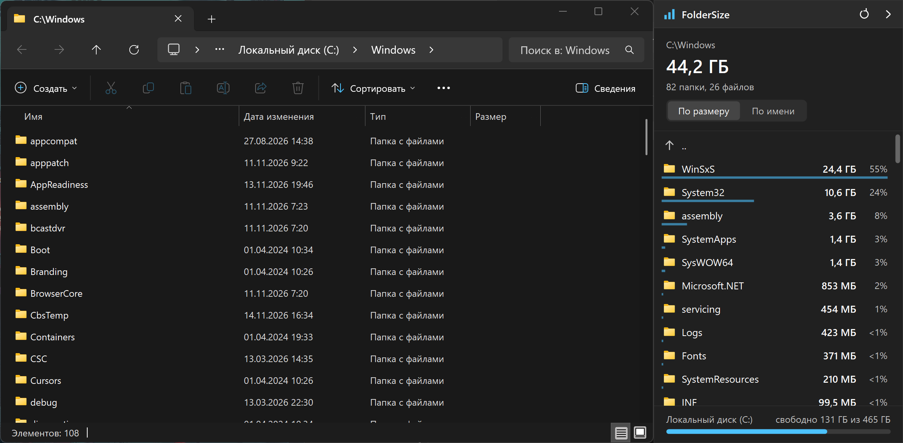

# Folder Size

Shows how much space every folder and file takes, right next to your file manager window. No need to open "Get Info" or run a separate disk analyzer: open a folder and you instantly see what is heaviest inside it.

- size of every item in the folder, sorted from largest to smallest;
- total size of the open folder with a share bar;
- total of the selected items;
- counting runs in the background and updates automatically when files change.

| Platform | Folder | Download |
|----------|--------|----------|
| macOS 13+ (Apple Silicon) | [`macos/`](macos) | [FinderSizes-macOS-0.2.dmg](https://github.com/in4in-dev/folder-size/releases/download/macos-v0.2/FinderSizes-macOS-0.2.dmg) |
| Windows 10/11 | [`windows/`](windows) | [FolderSizePanel-Setup-0.2.exe](https://github.com/in4in-dev/folder-size/releases/download/windows-v0.2/FolderSizePanel-Setup-0.2.exe) |

All versions are on the [Releases](https://github.com/in4in-dev/folder-size/releases) page.

---

## macOS


A panel appears to the right of the active Finder window. It moves and resizes together with the window and never takes focus away from Finder.

- **Click** a row to select that item in Finder too; **⌘-click** adds it to the selection, and the panel footer shows the total.
- **Double-click** opens a folder in the same window, or a file in its app.
- `≥` next to a size means the folder is still being counted. A lock 🔒 means part of the contents is unreadable without Full Disk Access; click it to open the right settings pane.
- The panel hides when there is no room to the right of the window or Finder is in full screen.
- The interface follows the system language: English and Russian are supported.

### Installation

1. Download [FinderSizes-macOS-0.2.dmg](https://github.com/in4in-dev/folder-size/releases/download/macos-v0.2/FinderSizes-macOS-0.2.dmg) from [Releases](https://github.com/in4in-dev/folder-size/releases).
2. Open the DMG and drag **FinderSizes** onto **Applications**.
3. Launch the app. The build is not notarized, so macOS may block it on first launch: right-click it → **Open**, or click **Open Anyway** in **System Settings → Privacy & Security**.

The app has no Dock icon. On first launch it adds itself to login items and starts with the system afterwards; you can turn this off in **System Settings → General → Login Items**.

### Permissions

| Permission | Why |
|------------|-----|
| Accessibility | track the position and size of the Finder window |
| Automation → Finder | find out which folder is open and what is selected, open folders on double-click |
| Full Disk Access (optional) | fully count protected folders (Mail, Safari, Library, etc.) |

### Building from source

Requires Xcode or Command Line Tools with Swift 5.9+.

```bash
cd macos
./build.sh        # build build/FinderSizes.app
./install.sh      # build, install into /Applications and launch
./make-dmg.sh     # build the FinderSizes-macOS-<version>.dmg installer into ~/Downloads
```

The scripts sign the app with the first "Apple Development" certificate found (or the one in `SIGN_ID`) so granted permissions survive rebuilds. Without a certificate an ad-hoc signature is used.

Translations live in `macos/Resources/<lang>.lproj`. To add a language, copy `ru.lproj`, translate the strings and add the language code to `CFBundleLocalizations` in `macos/Resources/Info.plist`.

Counting without the UI, e.g. to check speed:

```bash
macos/build/FinderSizes.app/Contents/MacOS/FinderSizes --scan ~/Downloads
```

---

## Windows


