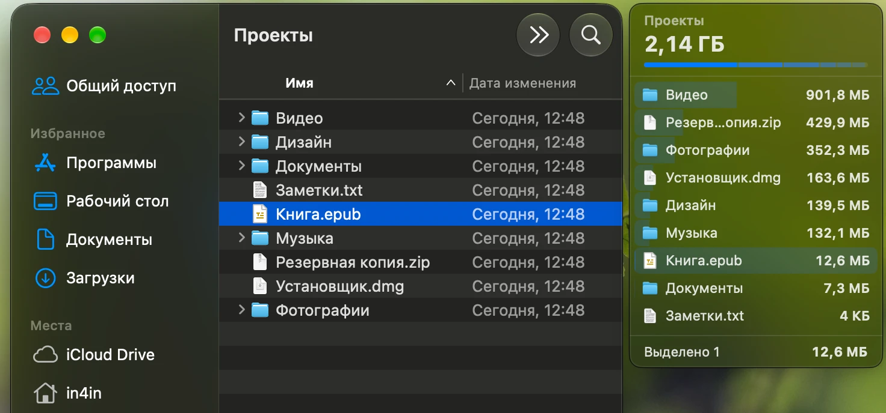

# Folder Size

A panel next to the file manager window that shows the size of every folder and file in the open folder.

- items sorted by size, with a share bar;
- total size of the open folder;
- background counting, updated when files change.

| Platform | Folder | Download |
|----------|--------|----------|
| macOS 13+ (Apple Silicon) | [`macos/`](macos) | [FinderSizes-macOS-0.2.dmg](https://github.com/in4in-dev/folder-size/releases/download/macos-v0.2/FinderSizes-macOS-0.2.dmg) |
| Windows 10/11 | [`windows/`](windows) | [FolderSizePanel-Setup-0.2.exe](https://github.com/in4in-dev/folder-size/releases/download/windows-v0.2/FolderSizePanel-Setup-0.2.exe) |

All versions: [Releases](https://github.com/in4in-dev/folder-size/releases). Interface languages: English and Russian, chosen by the system language.

---

## macOS



The panel sits to the right of the active Finder window and follows it.

- **Click** selects the item in Finder; **⌘-click** adds to the selection, the footer shows the total.
- **Double-click** opens a folder in the same window or a file in its app.
- `≥` — still counting. 🔒 — part of the folder needs Full Disk Access; click to open the settings.
- Hidden when there is no room to the right of the window or Finder is full screen.

### Installation

1. Download the DMG from [Releases](https://github.com/in4in-dev/folder-size/releases) and drag **FinderSizes** to **Applications**.
2. The build is not notarized: if macOS blocks it, right-click → **Open**, or **Open Anyway** in **System Settings → Privacy & Security**.

No Dock icon. Adds itself to login items on first launch (**System Settings → General → Login Items**).

| Permission | Why |
|------------|-----|
| Accessibility | track the Finder window position and size |
| Automation → Finder | read the open folder and selection, open folders |
| Full Disk Access (optional) | count protected folders (Mail, Safari, Library) |

### Building

Xcode or Command Line Tools, Swift 5.9+.

```bash
cd macos
./build.sh        # build/FinderSizes.app
./install.sh      # build, install into /Applications, launch
./make-dmg.sh     # FinderSizes-macOS-<version>.dmg into ~/Downloads
```

Signed with the first "Apple Development" certificate (or `SIGN_ID`) so permissions survive rebuilds; ad-hoc otherwise. Translations: `macos/Resources/<lang>.lproj` (add the code to `CFBundleLocalizations` in `Info.plist`).

```bash
macos/build/FinderSizes.app/Contents/MacOS/FinderSizes --scan ~/Downloads   # count without UI
```

---

## Windows


The panel sits next to the active File Explorer window and follows it.

- **Double-click** opens a folder in the same window or a file in its app; `..` goes up.
- **Right-click** — the Explorer context menu plus **Open in new window**, **Recalculate size**, **Copy path**.
- **By size / By name** — sort order. In **This PC** — drives with their size.
- Spinner — still counting. Footer — free space on the drive.
- Drag the outer edge to resize; the arrow in the header collapses the panel.
- For a maximized window the panel overlays its edge.

### Installation

Run `FolderSizePanel-Setup-<version>.exe` from [Releases](https://github.com/in4in-dev/folder-size/releases). No admin rights needed; installs into `%LOCALAPPDATA%\Programs\FolderSizePanel`, uninstall via **Settings → Apps**. The installer is unsigned: on a SmartScreen warning click **More info → Run anyway**.

Tray icon menu: show/hide panel, left/right side, start with Windows (on by default), clear cache, exit.

### Building

No dependencies — uses the .NET Framework 4.x compiler shipped with Windows.

```powershell
cd windows
.\build.ps1                 # bin\FolderSizePanel.exe and bin\FolderSizePanel-Setup.exe
.\build.ps1 -Install        # build, install, launch
.\build.ps1 -Version 0.3    # set the version
bin\bench.exe --bench C:\Windows   # count without UI
```

Release: push a `windows-v<version>` tag — GitHub Actions builds the installer and publishes it. `FOLDERSIZE_LANG=en|ru` forces the interface language.
